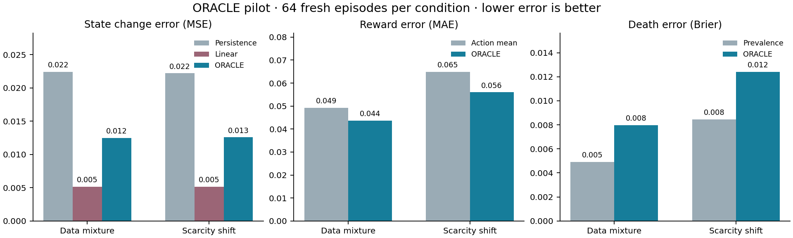

# Verified learning foundation — 12 October 2026

The new trained ORACLE improves one-step state prediction over persistence and reward prediction over a training action-mean baseline in this TidePool pilot. It loses state prediction to a training-only linear predictor and loses death Brier score to a prevalence-only baseline. Its prediction intervals remain broad. The paired control test failed: intact candidate survival was 0/48 versus 48/48 for frozen Tidal across three conditions. The artifact is rejected for promotion and remains inactive. Learned memory benefit and structural transfer remain unestablished.

This report records the first implementation tranche of the [learning and transfer design](../superpowers/specs/2026-10-11-learning-transfer-design.md) and its [implementation plan](../superpowers/plans/2026-10-11-learning-foundation.md). Prediction results come from `outputs/learning-foundation-632000000/fit/fit_receipt.json` and `outputs/learning-foundation-632000000/prediction/evaluation_receipt.json`. These generated artifacts are local evidence and may be absent from a fresh checkout. All three paired control receipts passed exact environment/controller replay. Compact results are preserved in [learning-foundation-results.json](learning-foundation-results.json). The full suite rerun passed 637 tests in 700.97 seconds after two test-fixture compatibility fixes; the production code used for the experiments is unchanged.

The candidate uses five independently initialized ensemble members, each with two 128-unit hidden layers, 16 observed features and six actions. Each member retains a fixed bootstrap draw of 128 complete training episodes; transitions are sampled from that member's resulting pool. Training requested 1,024 updates with batch size 128. Selection chose update 1,024, with the recorded composite selection loss `-3.57716703414917`. This loss combines state/reward Gaussian terms with weighted death classification; it is not a controller return. Execution uses one CPU experiment worker and two Torch threads. Episodes terminate at death or the 96-step horizon.

| Partition | Inclusive episode-seed range | Episodes | Transitions | Deaths | Horizon truncations |
| --- | --- | ---: | ---: | ---: | ---: |
| Train | 632000000–632000127 | 128 | 11,071 | 21 | 107 |
| Selection | 633000000–633000031 | 32 | 2,608 | 9 | 23 |
| Calibration | 634000000–634000063 | 64 | 5,629 | 10 | 54 |
| ID prediction test | 635000000–635000063 | 64 | 5,635 | 10 | 54 |
| Scarcity-shift prediction test | 636000000–636000063 | 64 | 5,233 | 15 | 49 |

All five partitions have disjoint seeds. `episode-mixture-v2` chooses one behavior per complete episode: teacher with probability 0.35, exploratory teacher 0.30, uniform random actions 0.25, or repeated rest 0.10. The exploratory teacher chooses a uniform random action with probability 0.18 on each step. Repeated rest supplies failure exposure without altering historical `tidepool-v1` dynamics. No calibration/test resampling is used to obtain favorable class counts. The observed training behavior counts are 61 teacher, 31 exploratory, 22 uniform random and 14 repeated-rest episodes.

Scarcity is drawn independently by the episode seed from `{0.8, 1.0, 1.25, 1.5}`. Calibration and ID testing use the same frozen generation law with independent seeds; their realized proportions need not be identical. The shifted test fixes scarcity at 2.5 and retains the behavior mixture. This is a scarcity shift within TidePool, not a change to the transition rules or a structural-world test. Unversioned historical artifacts retain explicit `legacy-v1` interpretation, including the historical evaluator's fixed ID scarcity of 1.25.

All actions occur in training and both prediction tests. Exposure is uneven and does not establish support for every state/action combination:

| Executed action | Training transitions | Training death transitions | ID test transitions | Scarcity-shift transitions |
| --- | ---: | ---: | ---: | ---: |
| Rest | 6,744 | 15 | 3,048 | 2,732 |
| Forage | 1,113 | 1 | 630 | 568 |
| Drink | 1,356 | 3 | 730 | 668 |
| Shelter | 525 | 0 | 376 | 323 |
| Explore | 582 | 2 | 368 | 517 |
| Flee | 751 | 0 | 483 | 425 |

Training contains 21 positive and 11,050 negative death-transition labels. Shelter and flee have no positive training death examples. Bootstrap members contain 81, 82, 78, 79 and 76 unique training episodes, respectively; their death-transition counts, including repeated episode draws, are 13, 31, 23, 33 and 23. The receipt retains each draw, multiplicity, membership digest and pool action count. These are pool exposures, not a claim that every transition was sampled in an optimization minibatch.

The prediction evaluator averages transition errors within each episode, then averages episodes equally. The comparisons below use the same executed transitions. Persistence predicts zero observation delta. The stronger state baseline fits a separate affine observation-to-delta map for each action, using training episodes only and ridge regularization `0.001`. Reward comparison uses the training mean reward for each action; death comparison uses smoothed training prevalence `0.0019868147746771427`.

| Error metric; lower is better | ID mixture | Scarcity 2.5 |
| --- | ---: | ---: |
| Ensemble state-delta MSE | 0.0124955 | 0.0125693 |
| Persistence state-delta MSE | 0.0224016 | 0.0221929 |
| Linear action-conditioned state-delta MSE | 0.00513605 | 0.00515655 |
| Ensemble reward MAE | 0.0437183 | 0.0560051 |
| Training action-mean reward MAE | 0.0492875 | 0.0648470 |
| Ensemble death Brier score | 0.00796586 | 0.0124030 |
| Training-prevalence death Brier score | 0.00492563 | 0.00846504 |

Positive gain means the candidate has lower error than the named baseline. Intervals are descriptive 95% bootstraps of paired episode differences, with 2,000 replicates; they do not account for multiple comparisons or variation across independently trained lineages.

| Paired gain | ID: estimate [interval] | Scarcity shift: estimate [interval] |
| --- | --- | --- |
| State MSE over persistence | 0.00990614 [0.00893653, 0.0108181] | 0.00962360 [0.00861277, 0.0106677] |
| State MSE over linear predictor | −0.00735945 [−0.00858442, −0.00626938] | −0.00741273 [−0.00864696, −0.00614994] |
| Reward MAE over action mean | 0.00556921 [0.00304851, 0.00858807] | 0.00884183 [0.00569472, 0.0121098] |
| Death Brier over prevalence | −0.00304023 [−0.00395281, −0.00214893] | −0.00393795 [−0.00513511, −0.00276883] |

The linear predictor has lower mean state error in every reported behavior subgroup in both conditions. The ensemble's state gain over persistence therefore does not justify treating the ensemble as the best available predictor. Death events are now present, fixing the earlier pilot's missing-positive-class limitation, but the death head still loses its simple comparator. It was trained with positive-class weight 30 and was not probability-calibrated. No discrimination score or survival certificate is established by this run. A separately trained single-network comparator and frozen Tidal dynamics predictor are still absent from this prediction assay.

Episode-max split-conformal calibration targets nominal coverage 0.90 using the 64 independent calibration episodes. The standardized state and reward quantiles are `9.516331672668457` and `16.272329330444336`. A covered state episode means every transition feature falls inside its corresponding interval; a covered reward episode means every transition reward falls inside its interval.

| Interval diagnostic | ID mixture | Scarcity 2.5 |
| --- | ---: | ---: |
| State episode coverage | 60/64 = 0.9375 | 63/64 = 0.984375 |
| Reward episode coverage | 62/64 = 0.96875 | 61/64 = 0.953125 |
| Mean state half-width | 0.770350 | 0.904922 |
| Mean reward half-width | 0.910764 | 1.098681 |

The state half-width is large relative to individual normalized observation ranges `[0,1]`; apparent coverage alone is weak evidence of useful decision precision. ID uniform-random episodes have mean state half-width 1.16521, rising to 1.41429 under the scarcity shift. Aggregate coverage also masks subgroup variation: ID exploratory state coverage is 21/24, and shifted repeated-rest reward coverage is 6/8. These small subgroups are descriptive and have no conditional coverage guarantee. The calibration scope is the registered behavior/environment mixture. It does not extend automatically to shifted scarcity, planner-selected actions or imagined multi-step trajectories.

The implementation now exposes the same trained research model through `ResearchOracleAdapter` in CognitiveAgent and HyperAgent when an artifact is explicitly selected. The interface checks artifact/config/source identity, validates finite inputs and outputs, reports action exposure and counts actual member calls. Runtime planning with this artifact is limited to one step. State-distribution support and selected-action calibration remain unverified; the adapter's action-count check is only a training-exposure check. The death output remains explicitly uncalibrated and is excluded from a calibrated failure-probability penalty. Without a selected trained artifact, the default path preserves frozen Tidal actions. No active model pointer is changed by fitting or evaluating this candidate.

The completed evidence repairs bind duplicated fit claims to the loaded artifact, reject contradictory resealed metadata and invalid weights, require complete disjoint partitions, and replay environment data, selected-checkpoint loss, calibration scores, bootstrap exposure and the linear baseline. Cognitive replay now validates complete arm/seed pairs, model/source identity, every executed transition and recomputed summaries, with prediction timing aligned to the executed action. True environment death and horizon truncation are separate from noisy observations; reset snapshots include sensor RNG state. The focused research suite passed 30 tests, including invalid artifacts, fabricated calibration, identical ID generation, mixture failure/action coverage and explicit legacy replay.

Parameter search now operates on copied baseline/candidate workspaces with seeded proposals, separate selection/audit seeds, explicit deadlines and inactive candidate artifacts. It requires explicit `--oracle` selection and copies/binds that artifact in each isolated workspace. Missing model selection or an entirely disabled planner stops the search as inactive before further proposals; baseline fallback cannot masquerade as useful predictive parameter search. Rejection or cancellation does not restore, commit or promote the shared checkout. The final ORACLE-aware search suite passed 20 focused tests in 68.74 seconds (`outputs/test-auto-improver-oracle-final/` fixtures; pass recorded by the implementing agent). These include copied-artifact forwarding, hash tampering at baseline/candidate/audit, disabled-planning rejection, deadlines and preservation of dirty source/Git state. The actual no-artifact CLI smoke also produced an inactive report with zero proposals and no baseline copy under `outputs/learning-foundation-632000000/search-inactive/`. No new parameter-search performance gain is claimed here. The first full suite recorded 635 passes and two fixture failures (expected missing-file exception type and a CLI runtime mock missing the new optional keyword). Both fixtures were corrected; the rerun passed 637 tests in 700.97 seconds (`outputs/learning-foundation-full-tests-final.log`). No production change was required by those failures.

The default and explicitly trained CLI smoke records, `outputs/learning-foundation-default-cli.json` and `outputs/learning-foundation-trained-cli.json`, both report successful verification. These are four-step route/inference checks on different seeds, so their rewards are not a paired efficacy comparison.

The paired control assay completed 16 fresh seeds per condition with a 64-step limit and six arms: intact, erased, shifted, random retrieval, memory free and frozen Tidal. Clean scarcity 1.25, clean scarcity 2.5 and noisy scarcity 2.5 use seed namespaces 637000000, 638000000 and 639000000. All condition receipts passed exact controller/environment replay. These namespaces are consumed evaluation data.

| Control condition | Intact reward | Frozen reward | Paired reward difference [95% bootstrap] | Intact / frozen survival |
| --- | ---: | ---: | --- | --- |
| Clean scarcity 1.25 | -1.5566 | 6.4454 | -8.0020 [-8.4749, -7.5058] | 0/16 / 16/16 |
| Clean scarcity 2.5 | -2.2182 | 6.5047 | -8.7228 [-8.9941, -8.4513] | 0/16 / 16/16 |
| Noisy scarcity 2.5 | -2.0384 | 6.4811 | -8.5195 [-8.8105, -8.2624] | 0/16 / 16/16 |

Planning was enabled on every intact step, so this failure exercised the loaded model. Intact runs made 38,280, 31,380 and 35,100 member forward calls respectively; each decision queried six planner previews and six active-inference previews across five ensemble members. Overrides occurred on roughly 79–84% of steps. Intact agents never chose shelter or explore in these traces; death reasons include exposure, dehydration, exhaustion and hazards. These are observations of the combined controller, not an isolated causal diagnosis of any one score term.

All four memory lesions produced exactly the same action traces and returns as intact in all 48 matched pairs. This assay provides no evidence that the current memory heuristic improves decisions. Prediction gains over weak baselines did not translate into control gains, and the available failure-probability and interval diagnostics did not justify intervention. The recorded promotion decision is rejection (`outputs/learning-foundation-632000000/candidate_decision.json`). The default runtime continues to use frozen Tidal; explicit artifact selection remains available for reproducible research only.



The saved artifact identities are:

```text
oracle.pt SHA-256:
44a2400caa4a1008c045a0421ee5ab8d59b35165e2680082674ade339b3c0867
model-state SHA-256:
6fdb20180cc5fdefa88bd2f5512f40086ac39943bd0f189b8505c2c920f8d017
fit receipt SHA-256:
c5bd8d2af69cec3a6321544c54e96ff87dec3102beec19148035f62072f9c3ff
prediction receipt SHA-256:
a935ae62d524f9d794027c9ed0ebf17ecb1d8be9d6b500fd00112e9d5c0be719
```

The historical [11 October audit](architecture-audit-2026-10-11.md), its original diagnostics and original `outputs/oracle-fit-442000000/` and `outputs/oracle-eval-442000000/` receipts are preserved. Historical research sources are under `outputs/architecture-audit-2026-10-11/source-snapshot/poseidon/research/`. The new frozen runtime is archived in `outputs/learning-foundation-632000000/runtime-source.zip`, with `runtime-source-sha256.json`. Source drift causes replay/compatibility checks to reject mismatched code rather than reinterpret old evidence. The local wheel parity record reports exact source-byte matches for 124 Python files; it does not establish publication or full installed-package behavior.

The following PowerShell commands reproduce the protocol from the project root with installed dependencies. The wrapper fixes Torch to two threads. Use the matching archived source revision and empty output directories; the `-reproduction` path preserves the original evidence. Repeating these evaluated seeds is a reproduction, not a new independent test. Run one experiment command at a time.

```powershell
$env:TEMP = Join-Path (Get-Location) 'outputs\learning-foundation-temp'
$env:TMP = $env:TEMP
New-Item -ItemType Directory -Path $env:TEMP -Force | Out-Null
$cli = 'import torch; torch.set_num_threads(2); from poseidon.cli import main; main()'

python -c $cli oracle-fit --seed 632000000 --output outputs/learning-foundation-632000000-reproduction/fit --oracle-train-episodes 128 --oracle-selection-episodes 32 --oracle-calibration-episodes 64 --oracle-updates 1024 --oracle-batch-size 128 --oracle-hidden-size 128 --oracle-ensemble-size 5 --oracle-coverage 0.90 --oracle-data-protocol episode-mixture-v2 --max-steps 96

python -c $cli oracle-evaluate outputs/learning-foundation-632000000-reproduction/fit/oracle.pt --seed 632000000 --eval-episodes 64 --bootstrap-reps 2000 --output outputs/learning-foundation-632000000-reproduction/prediction

python -c $cli verify-oracle-fit outputs/learning-foundation-632000000/fit/fit_receipt.json
python -c $cli verify-oracle-evaluation outputs/learning-foundation-632000000/prediction/evaluation_receipt.json

python -m tools.evaluate_learning_foundation --artifact outputs/learning-foundation-632000000/fit/oracle.pt --output outputs/learning-foundation-632000000-reproduction/control --seed 637000000 --episodes 16 --max-steps 64

python -c $cli world --planner cognitive --oracle-checkpoint outputs/learning-foundation-632000000/fit/oracle.pt --seed 642000002 --scarcity 1.25 --max-steps 16
```

The commands preserve the recorded finite update/episode budgets; the standalone fit CLI does not itself enforce a wall-clock deadline. For an isolated parameter-search smoke, the existing tool has explicit duration and proposal limits: `python tools/auto_improver.py --oracle outputs/learning-foundation-632000000/fit/oracle.pt --duration-hours 0.01 --max-iterations 1 --seed 1729 --output-dir outputs/isolated-search-reproduction`. The example uses the explicitly rejected research artifact only to exercise the search path; it is not a deployment recommendation. Omitting `--oracle` returns inactive (exit 2) with a recorded reason. A selected candidate stays inactive and requires independent audit evidence; running this command is not needed to reproduce the prediction tables.

The next learning experiment should start with the demonstrated stronger state baseline: freeze a training-only action-conditioned linear predictor and train a small residual predictor initialized to zero, so its initial state forecast equals that baseline. Compare linear alone, linear plus residual, the current ensemble family and a matched single trained predictor at equal declared data/update budgets. Change residual capacity, regularization, target scaling and checkpoint selection using training/selection episodes only, with validation state MSE against linear as a direct gate. Preserve separate reward/death diagnostics; do not treat the current class-weighted death head as calibrated risk. Freeze the chosen model before collecting fresh calibration and final evaluation episodes. Reserve a new, checked-disjoint test namespace; the evaluated 635/636 million prediction seeds and 637–639 million control seeds are consumed and must not be reused to accept the revised candidate. Report failure if the residual does not beat linear, alongside interval width and coverage.

Later design gates remain open: construct and validate a history-dependent alias challenge; fit memory-conditioned predictors and a utility-based retriever with training-only cross-fitting; verify causal prediction/action changes against erased, shuffled and stale-memory controls; calibrate the frozen action-query family; and test whole-controller reward and survival on untouched ID and genuinely changed transition-rule regimes across independent trained lineages. Online adaptation, external/3D transfer and release promotion require their separate retention, replay and publication checks. This foundation makes those experiments inspectable; it does not establish their outcomes.
