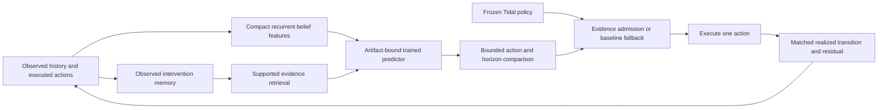

# Poseidon learning and transfer operation design

Date: 11 October 2026. Status: proposed architecture for review; implementation and performance acceptance are pending. Baseline inspected: `97eebc637865a815b458c50fb7ef8200ef1c61df`, including the new v3 and OmniPlane additions. Recheck source identity before executing the operation.

## Purpose and success

The user's goal is a substantial, distinctive advance informed by all 24 supplied projects and current research. The working assumption is CPU-local development on this PC. The target is an agent that learns useful information, uses it in decisions and transfers it to unfamiliar synthetic environments. Adding subsystem names or obtaining lower training loss does not satisfy that purpose.

Success requires three separately reported results: better held-out prediction than useful trained/simple baselines; measurable decision benefit from acquired memory under controlled interventions; and retained baseline ability on untouched transfer episodes. Negative or inconclusive results remain valid research outcomes, but cannot activate or justify a promoted model. No global novelty, biological fidelity, quantum advantage, AGI or real-world safety claim is proposed.

The [portfolio refresh](../../research/portfolio-refresh-2026-10-11.md) documents all 24 source identities and mechanisms. The [local audit](../../research/architecture-audit-2026-10-11.md) records runtime gaps and measured pilot limits.

## Three approaches

| Approach | Benefit | Cost and limitation | Decision |
| --- | --- | --- | --- |
| Integrate and calibrate the existing research predictor only | Resolves random-runtime prediction and enables honest prediction comparisons. | Essential foundation, but does not itself demonstrate learned memory or transfer. | First milestone in every approach. |
| Integrate prediction, then learn the decision value of episodic evidence | Tests whether remembered outcomes improve action choice across hidden regimes and delayed cues. Uses compact models and exact synthetic branches. | Requires strong causal controls, frozen selection and separate transfer tests; improvement is uncertain. | Recommended flagship after the foundation passes. |
| Expand 3D, morphogenesis, quantum-inspired scoring and introspection first | Broader interactive demonstration and architecture experiments. | Larger validation burden while predictor/control gaps remain. Rendered novelty is weak evidence of learning. | Retain as later optional controls and adapters. |

## Flagship mechanism: memory that predicts its decision value

An agent may remember a resource patch accurately yet make a poor choice when the patch's replenishment regime changes. Train a compact retriever to estimate whether a past *observed intervention and outcome* helps the current decision. It should distinguish useful, stale, conflicting and unsupported evidence, rather than prioritizing absolute reward or similarity alone.

The current research ORACLE is the starting predictor. Existing Helm history/return features are the reference for useful residual memory, not a component to rebuild. Add a learned episodic correction path with zero initial influence and an explicit admission gate. Predictive utility is a training auxiliary; the main utility label comes from actual paired branch returns in the synthetic world.

At time `t`, features contain observation history through `o_t`, completed actions through `a_(t-1)`, and correctly aligned prediction residuals. Candidate action `a_t` is an explicit query. Hidden simulator coordinates, latent regime labels, the future successor and realized branch returns are excluded from inference features. Future outcomes can be supervised labels during training only. Arbitrary regeneration or environment identity is not exposed as a privileged shortcut.

At training anchors, first execute all six initial actions with frozen Tidal continuation for horizons 4 and 8. Fit fold-specific memory-conditioned return predictors from these branch labels, with memory dropout supplying the no-retrieval condition. The deployment admission gate remains closed while these offline predictors learn; zero initial deployment influence must not force the training proposals to remain identical. Freeze each fold predictor before it generates utility labels on the other training fold. Compare the true recorded branch return of its memory-conditioned proposed action with that of its no-retrieval proposal. Identical actions receive zero action-benefit credit. Report proposal diversity and positive/negative/zero utility counts; if every label is zero, stop and diagnose the task/proposal generator. These labels concern the fixed continuation, not the full adaptive controller. The eventual whole-episode assay measures the complete frozen controller separately.

Every anchor snapshot includes world version/state, observation tick, sensor-noise generator state or named-event noise identity, recurrent belief, episodic entries, prediction cache and model/config identity. The existing POMDPTidePool snapshot stores only the underlying world, so it is insufficient for exact noisy branch replay. Use named-event observation noise keyed by episode/tick/channel in new research variants, or serialize/restore its complete generator state. Clone controller and sensor state for each branch and memory intervention; no shared mutable state may leak between them.

Use training-only cross-fitting to construct utility labels without scoring a retriever on episodes used to fit its label predictor. Keep all folds within the original training partition. A small ridge/MLP utility scorer and a 32- or 64-unit GRU are sufficient first candidates. Compare with observation-only, four-frame stack, linear recurrent memory and existing Helm. Choose context length and model family only on selection data. No diffusion video model or large language retraining is required for this mechanism.

Memory entries record episode/tick/action identity, before/after observed features, reward, aligned residual, candidate/model version and age. Filter support before ranking. Capacity is 256 entries, retrieve at most four, and expose candidate count, distances, stale exclusions, conflict scores and prediction changes. Unknown environment support produces an explicit unsupported result. Cross-episode memory is an explicit experimental condition; the default episodic condition resets at every episode.

## One predictor contract

Define a single prediction adapter that loads the research artifact and exposes state mean/scale, reward mean/scale, death-event estimate, action support and calibration status. Bind observation/action semantics, model/config, preprocessing, complete source dependencies and training protocol to it. Both CognitiveAgent and HyperAgent use the same interface when opted in. Keep legacy random ensembles as labeled diagnostic controls only.

The research trainer already records fixed whole-episode bootstrap draws per ensemble member. Preserve that implementation and add membership/exposure digests, per-action support and per-regime diagnostics. Avoid an incompatible third ORACLE. Add matched single trained predictor, linear action-conditioned delta, frozen Tidal dynamics, persistence, action-mean reward and prevalence-only death baselines. A random ensemble is a negative control, not the primary comparator.

Failure probability is not a survival certificate. If the training or audit set lacks positive death events, mark that target unevaluated and prevent its use as calibrated risk. Treat death and time-limit truncation separately. Report Brier score, discrimination only where both classes occur, prevalence and action coverage; avoid presenting class-weighted logits as calibrated probabilities.

## Environment and data design

Keep historical `tidepool-v1` and its replay semantics intact. Introduce explicitly versioned research variants for hidden delayed resource cues, replenishment changes and observation aliases. The alias challenge must contain equal current observations with different action consequences that can be distinguished from previously observed history. Test this property with hand-constructed cases before collecting training data. A full-state oracle is an evaluation diagnostic only.

Assign original world families to fit, selection, calibration and test before deriving branches, augmentations or memory variants. Record family IDs, environment versions, source digests and episode seeds. Entire changes in regeneration/transition rules are reserved for structural OOD; merely changing a seed or scarcity value is a narrower test.

Use a preregistered mixture of whole-episode behavior policies: competent teacher, controlled exploratory policy and uniform random actions. Development episodes determine whether the task is learnable and avoids saturated survival. Freeze the mixture before final collection. Include sufficient training action exposure and both survival and death examples. Do not keep resampling calibration/test episodes until a favorable class balance or result is obtained. Missing class coverage makes that assessment inconclusive.

For marginal prediction calibration, sample ID calibration and ID test episodes from the same frozen environment/behavior mixture with independent family seeds. Report subgroup coverage and sharpness without claiming conditional guarantees. Structural-OOD coverage is descriptive only.

For action admission, freeze the retriever, proposal/scoring rules, queried action/horizon set and calibration anchor behavior before collecting calibration episodes. At each anchor obtain actual six-action branch returns at both horizons. For each declared controller/memory family, calculate standardized return overestimation, take the maximum across all queried actions/horizons, then take the episode maximum. Fit family-specific radii from these episode scores and record support failures and effective counts. Executed-action residuals alone cannot calibrate the selected alternative. Freeze the resulting radii and gates before final controller evaluation.

The calibration anchor behavior is frozen Tidal continuation with scheduled anchors; deploying the gated controller changes the visited-state distribution. Its radii therefore serve as empirical admission heuristics, not a conformal guarantee for the deployed adaptive trajectory. Report post-gating forecast errors, admission rates and support on independent full-controller episodes. Any subsequent threshold, retriever or proposal change requires new calibration and untouched final seeds. Claims of coverage must name the actual exchangeable query distribution and cannot extend automatically to the selected controller or structural OOD.

## Action selection and compute

Start with one-step prediction and observed branches at horizons 4 and 8. Enable a longer horizon only after separate multi-step error diagnostics support it. Recompute latent/history state during imagined trajectories rather than repeating one fixed embedding. Maintain baseline fallback whenever candidate support, artifact identity, finite output or admission requirements fail.

Correct metacognitive prediction timing before it controls compute. Its horizon recommendation must change actual model calls if adaptive compute is claimed. Measure member-forward counts, imagined transitions, retrieval work, action latency and CPU time in addition to reward. Use a fixed inference budget when comparing alternative planners. Energy in a simulated organism is not the electrical cost of CPU inference.

Inactive optional adapters must reproduce baseline actions exactly. Online dream updates, morphogenesis and sleep consolidation are disabled in the frozen transfer condition; evaluate them later as separately declared adaptation arms with fresh artifact hashes, acquisition budgets and retention anchors. Introspective text summarizes logged evidence and has no independent truth status.

## Evidence and verifier contract

Receipts validate a closed schema, expected arms/seeds, unique complete pairs, source/world/model identity, action ranges, finite values, terminal semantics and complete raw trajectories. Replay every executed transition and recompute outcomes and paired summaries. Branch evidence records anchor snapshot, continuation policy identity and all executed actions. Hash equality alone cannot certify any of these facts.

Bind every duplicated fit-receipt manifest, configuration, training, calibration and activation field to the loaded artifact. Bounded stable reads hash exactly the parsed bytes. Explicitly distinguish checksum validation, environment replay, model prediction replay and outcome acceptance. Zero effective rows is an error. Interrupted/cancelled runs are partial and cannot satisfy acceptance.

The verifier test bank must reject invalid schema, empty evidence, missing/duplicate pairs, changed actions/rewards/terminal state, wrong checkpoint, contradictory resealed calibration, nonfinite tensors, source drift and split leakage. Wrong-action, shifted-time and constant predictors are statistical negative controls: valid artifacts may load, but the assay must expose their expected deficits rather than relying on schema rejection. Record the number and type of effective checks.

## Frozen transfer assay

Freeze the selected weights, retriever, preprocessing, memory acquisition rules, support gate and planning thresholds before calibration and final evaluation. Test at least these arms: frozen Tidal, trained predictor without episodic correction, learned retrieval, equal-budget similarity retrieval, erased memory, shuffled donor memory and stale/wrong-regime memory. Existing TRIDENT and Helm provide stronger controller references in a separate comparison if CPU budget prevents a single wide assay. Retain raw results for every planned pair.

Primary endpoints: paired whole-episode reward advantage of learned retrieval over the same predictor without retrieval on unseen memory-relevant ID episodes **and separately on a preregistered structural-transfer regime**. Predeclare which structural regime is confirmatory and which additional regimes are sensitivity tests. Require survival noninferiority against frozen Tidal in both confirmatory conditions. A transfer claim requires the structural endpoint and its retention guard to pass; ID improvement alone cannot satisfy it. Report support/admission rates, action changes caused by retrieval and complete outcomes including fallback episodes, so abstaining everywhere cannot be presented as useful transferred memory.

Secondary outcomes include resource revisits, adverse overrides, forecast error, interval sharpness, retrieval influence, latency and compute. Predeclare practical reward and survival margins from development distributions before final data. A confidence interval spanning the required effect or retention bound is inconclusive, even if its point estimate looks favorable. Failure in the confirmatory structural regime prevents the transfer claim; failed sensitivity regimes narrow its stated scope.

Use episode-level intervals and report win/tie/loss plus leave-one-seed-out influence. Repeat across independently trained lineages. Separate ID, scarcity shift and structural OOD results; do not average away a failed regime. Frozen transfer permits no online weight adaptation. Within-episode evidence acquisition is defined in every arm and equally budgeted. Labels from final test episodes never change a candidate or gate; a revised candidate uses a new untouched final namespace.

## Ordered operation and deliverables

| Stage | Concrete work and likely files | Completion evidence |
| --- | --- | --- |
| 0. Stabilize identity and claims | Audit source (done); correct README/research authorship and readiness (done); isolate `tools/auto_improver.py` candidates and remove repository-wide restore (pending). Preserve concurrent work. | Accurate capability table, clean scoped diffs, candidate rollback confined to its own snapshot. |
| 1. Repair evidence | Extend `research/oracle_training.py` binding and `cognitive_experiment.py` replay; correct terminal state/snapshot/residual timing in `cognitive_agent.py`; audit corresponding HyperAgent behavior. | Positive receipts replay; all contract mutants fail; statistical mutants are reported; truthful terminal metrics. |
| 2. Establish useful trained prediction | Extend existing research contracts/training/evaluation with policy mixture, failure/action exposure, stronger trained baselines and matching calibration distribution. | Finite reproducible artifacts; frozen splits; prediction gains and target limitations reported by regime. No promotion from prediction alone. |
| 3. Wire one predictor | Explicit artifact adapter in runtime/cognitive/hyper paths, with untrained and unsupported states. | Loaded identity visible; actual predictions equal research inference; changed artifact/contract fails closed; default incumbent parity. |
| 4. Build memory challenge and scorer | Versioned research worlds, causal history fixtures, compact recurrence and learned utility retrieval. Reuse Helm as a reference. | No future leakage; memory changes prediction/action in constructed cases; intact and sham controls agree where they should. |
| 5. Freeze, calibrate and test transfer | Complete-controller calibration, paired untouched episodes, independent lineages and compute counters. | Raw complete pairs, replay, outcome/retention intervals, causal memory controls and explicit failed/inconclusive regimes. |
| 6. Controlled adaptation and information seeking | Candidate-only sleep/adapter updates from completed training batches; compare targeted probes with random equal-budget probes. | Independent retention and adaptation audit before admitting a candidate; cancelled batches preserve incumbent. |
| 7. Interactive and 3D validation | Typed external adapter identity/units/ticks, bounded jobs, compact replay, UI reporting of actual memory influence and readiness. | Responsive cancellation, adapter contract tests, source/package parity and live browser checks. |
| 8. Release | Build runtime package, evaluation report and model card from the verified exact revision/artifact. | Package smoke; GitHub SHA alignment; Hugging Face revision, files and hashes verified. Publication is reported separately from measured capability. |

The first model-development smoke run uses small fixture-scale splits and two updates; it establishes plumbing only. A bounded predictor pilot starts at 128 training, 32 selection and 64 calibration episodes, five 128-unit members, up to 1,024 updates and 96 steps per episode. These counts are proposed resource limits, not powered evidence thresholds. Check action/failure exposure before fitting and stop if the protocol is inadequate. A full transfer confirmation budget is chosen from development variance and measured runtime before freezing final seeds.

Run one CPU experiment worker with two Torch threads, explicit transition/update/deadline limits, durable progress and cancellation. Start with a 30-minute pilot deadline and a maximum 2 GiB artifact/evidence budget. Observe memory/disk use during preflight; platform limits are application controls, not OS isolation. Deadline exhaustion yields partial evidence. Never call a partial run completed or silently lower final assay requirements to fit a budget.

Implementation should proceed in small reviewed changes following these dependency gates. The operation does not require importing donor code or weights, cloud training or broad language-model retraining. Language, media and mathematical capabilities retain their existing contracts while this survival-learning mechanism is developed.

## Research basis and limitations

The following primary sources were checked on 11 October 2026. They inform design choices and controls; their performance results are not Poseidon measurements.

- [Why Linear Recurrent Memory Works in Partially Observable Reinforcement Learning](https://proceedings.mlr.press/v306/zhao26j.html), ICML 2026: motivates a compact action-conditioned recurrent baseline. Its theoretical constructions assume particular hidden-state transition structure; arbitrary TidePool or 3D dynamics do not inherit those guarantees.
- [Zero-Shot Reinforcement Learning Under Partial Observability](https://arxiv.org/html/2506.15446v1), RLC 2025: conditions learned components on observation/action history and separates partial-state and changed-dynamics tests. This motivates explicit recurrence and structural transfer controls. Its large continuous-control training setup is not a CPU-local reproduction target.
- [Learning What to Recall / Future-Aware Recall](https://arxiv.org/html/2609.34677v1), 28 September 2026 preprint: trains recall using predictive utility from realized futures while inference uses past/current cues. Poseidon's proposed extension tests *decision utility* with executed synthetic branches. That extension is a hypothesis; FAR's video prediction experiments do not establish policy benefit.
- [WIMLE](https://sfuapex.ca/publication/wimle/), ICLR 2026: separates stochastic future variation from ensemble disagreement and weights imagined data by uncertainty. This motivates checking both sources of error and compounding bias. It does not make disagreement a calibrated risk probability; its full continuous-control architecture is deferred.
- [Deep SPI: Safe Policy Improvement via World Models](https://proceedings.iclr.cc/paper_files/paper/2026/hash/0212b0dff7b4aa3bd8b8cc4ce24fd384-Abstract-Conference.html), ICLR 2026: links model/representation losses with restricted policy updates. Use conservative candidate updates and retention measurements; do not transplant its theorem to Poseidon's heuristic guards.
- [TD-MPC2](https://arxiv.org/abs/2310.16828), ICLR 2024: supplies a mature reference for learned latent prediction and bounded local planning. Poseidon's six-action CPU experiments are a different scale and evaluation setting.
- [A Gentle Introduction to Conformal Prediction](https://arxiv.org/abs/2107.07511), revised 2022: supports careful calibration terminology and exchangeability requirements. Grouping by complete episodes addresses within-episode dependence but does not itself fix changed behavior or environment distributions.

The distinguishing research question is whether historical interventions can be retrieved according to their incremental control value and transferred across hidden regimes at a fixed compute budget. Existing retrieval, recurrent RL and safe-improvement work are adjacent. A positive result would be evidence for this specific synthetic protocol, not proof of general cognition or unique invention.

## Review decision

Recommended: approve the integration-first, decision-utility-memory direction, with evidence repair and useful prediction as mandatory prerequisites. After the written design is reviewed, produce the detailed implementation plan and choose sequential work in this checkout or isolated agent tasks. The existing concurrent commits make an explicit source identity check necessary before any code edit.
